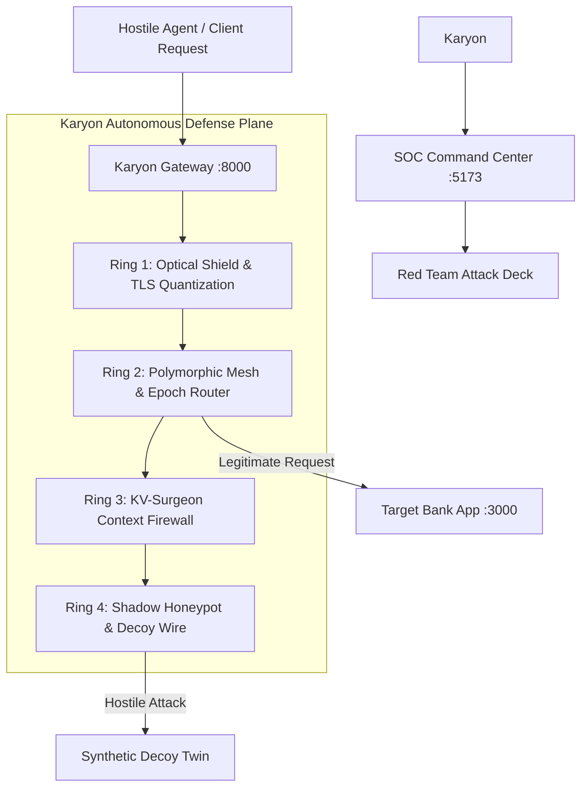

# Karyon Documentation

Welcome to the comprehensive technical documentation for **Karyon** — the Autonomous Moving-Target Defense (MTD) Plane for Enterprise AI.

---

## Documentation Index

| Document | Description | Status |
| :--- | :--- | :--- |
| **[Architecture Overview](file:///C:/Users/vaidz/documents/karyon/docs/architecture-overview.md)** | Core system topology, 4-Ring defense plane, request flow, and AI reasoning plane. | `Operational` |
| **[Ring 1: Optical Shield](file:///C:/Users/vaidz/documents/karyon/docs/ring-1-optical-shield.md)** | Dynamic SVG distortion filters, session CSS camouflage, quantized TLS jitter, and anti-scraping. | `Operational` |
| **[Ring 2: Polymorphic Mesh](file:///C:/Users/vaidz/documents/karyon/docs/ring-2-polymorphic-mesh.md)** | 60-second route mutation, ephemeral SQLite view virtualization, and BOLA API defense. | `Operational` |
| **[Ring 3: KV-Surgeon](file:///C:/Users/vaidz/documents/karyon/docs/ring-3-kv-surgeon.md)** | Sub-120ms RoPE tensor splicing, Merkle DAG tracking, and prompt injection eviction. | `Operational` |
| **[Ring 4: Shadow Honeypot](file:///C:/Users/vaidz/documents/karyon/docs/ring-4-shadow-honeypot.md)** | Meta Muse Spark synthetic decoy generation, canary token traps, and zero-403 deception. | `Operational` |
| **[SOC Command Center](file:///C:/Users/vaidz/documents/karyon/docs/soc-command-center.md)** | Real-time telemetry, red-team simulator deck, Recharts analytics, and attack ledger. | `Operational` |
| **[Target Integration & Audit](file:///C:/Users/vaidz/documents/karyon/docs/target-integration-audit.md)** | ApexFin Target Banking app, pre-flight perimeter scanning, and topology provisioning. | `Operational` |
| **[API Reference](file:///C:/Users/vaidz/documents/karyon/docs/api-reference.md)** | FastAPI gateway endpoints, WebSocket events, and telemetry schemas. | `Operational` |
| **[Black October & Differential A/B Proof](file:///C:/Users/vaidz/documents/karyon/docs/black-october-and-differential-proof.md)** | Live A/B differential proof benchmark, zero-day virtual patcher, and protection modes. | `Operational` |
| **[Enterprise SDK & Cloud Deployment](file:///C:/Users/vaidz/documents/karyon/docs/sdk-and-cloud-deployment.md)** | Drop-in 1-line FastAPI middleware, React optical boundary, live DOM capture, and single-port mounting. | `Operational` |
| **[Verification & Testing](file:///C:/Users/vaidz/documents/karyon/docs/verification-and-testing.md)** | Test suite coverage (26/26 pytest), Playwright UI validation, and confusion matrix. | `Verified` |

---

## What Karyon Does

Modern security relies on static defenses: firewalls, rate limiters, and WAFs that inspect incoming traffic against static rules. When attackers discover a vulnerability or AI agent uses vision/OCR to scrape data, static defenses fail silently.

**Karyon shifts the paradigm from static defense to an autonomous moving-target defense plane:**
1. **Never stands still**: API routes, schema columns, and visual DOM elements constantly mutate every 60 seconds (Epoch Rotation).
2. **Deceives instead of denying**: When hostile requests arrive (e.g. BOLA / IDOR attacks), Karyon serves high-fidelity synthetic twins generated by **Meta Muse Spark** rather than a `403 Forbidden` error. Attackers waste compute without realizing they are quarantined.
3. **Protects AI context memory**: If an attacker attempts prompt injection or RAG poisoning, Ring 3 isolates and evicts the exact poisoned attention blocks using Rotary Position Embedding (RoPE) tensor splicing in $< 120\text{ms}$ without disconnecting valid user sessions.
4. **Camouflages optical surface**: Vision models and OCR scrapers receive perturbed CSS and SVG displacement filters that render text illegible to automated agents while remaining crystal clear to human eyes.



---

## Quick Start & Service Topology

Karyon operates three primary services:

| Component | Port | Technology | Purpose |
| :--- | :--- | :--- | :--- |
| **Backend Gateway** | `8000` | FastAPI, Uvicorn, Python 3.12 | 4-Ring defense engine, proxy router, WebSocket telemetry |
| **Karyon Platform UI** | `5173` | React 19, Vite, Tailwind CSS, Framer Motion | Landing page, Perimeter Audit, and SOC Command Center |
| **ApexFin Target Bank** | `3000` | React 19, Vite, Tailwind CSS | Protected target banking application undergoing live audit |

To start all services:
```powershell
# Windows
.\start_karyon.bat

# Linux / macOS
./start_karyon.sh
```

Or start individually:
```bash
# 1. Gateway
python -m uvicorn backend.server:app --host 127.0.0.1 --port 8000 --reload

# 2. Target Bank
cd target_frontend && npm run dev

# 3. Karyon UI
cd frontend && npm run dev
```
