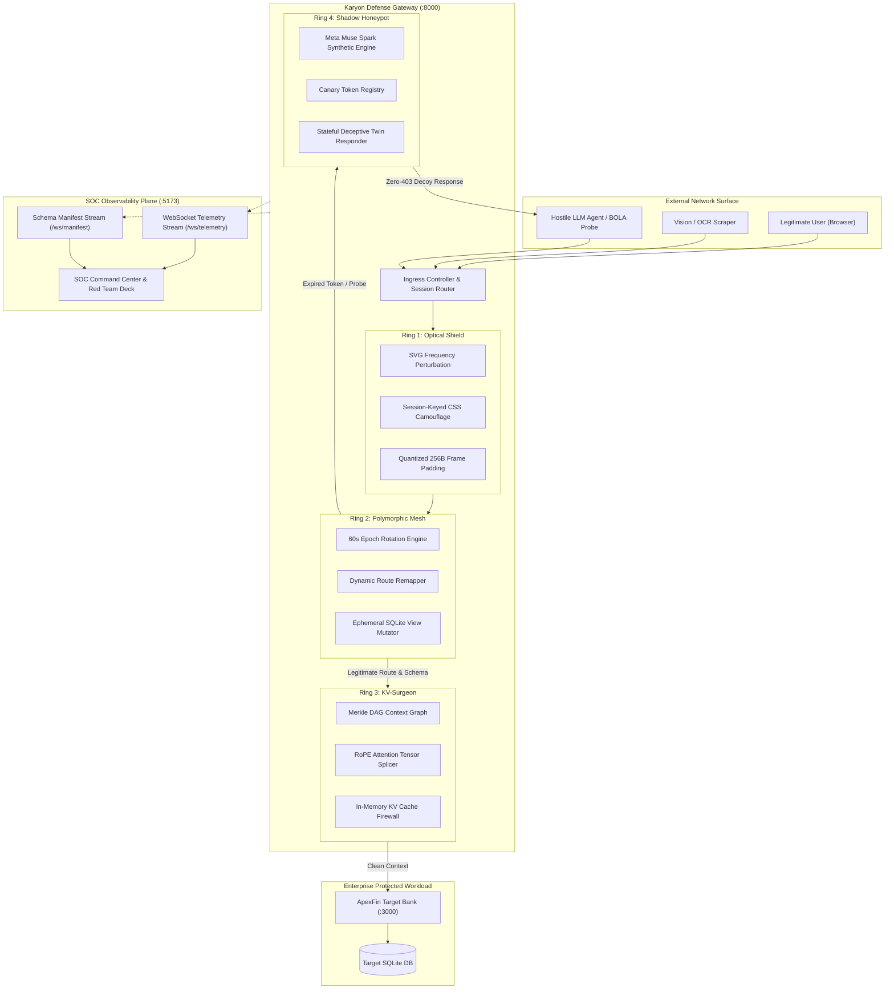
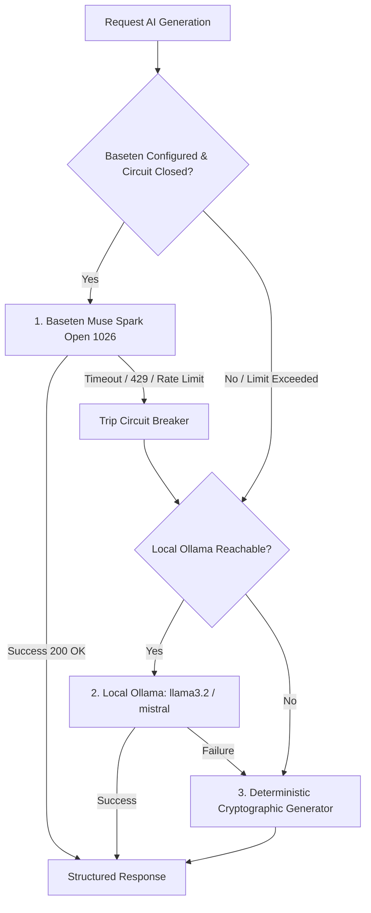

# Architecture Overview

This document describes the architectural design of **Karyon**, explaining how the Autonomous Moving-Target Defense plane operates, how requests flow through each defensive ring, and how the hybrid AI engine orchestrates real-time deception and schema rotation.

---

## 1. High-Level System Architecture

Karyon operates between incoming network traffic (human users, automated scrapers, hostile AI agents) and the underlying enterprise backend services (e.g., banking systems, LLM inference endpoints, SQL databases).

---

## 2. Request Lifecycle & Traffic Classification

When a request arrives at Karyon (`:8000`), it traverses a 4-stage pipeline:

### Stage A: Ingress & Optical Session Verification (Ring 1)
1. **Session Fingerprinting**: The gateway inspects session headers and client cookies.
2. **TLS Packet Padding**: Outgoing responses are padded to the nearest multiple of $256\text{B}$ using random non-actionable bytes, destroying packet-size fingerprinting patterns.
3. **Visual Filter Injection**: If an automated scraper or vision agent is detected, Karyon injects session-isolated SVG `<feDisplacementMap>` filters and CSS transforms that distort text pixels at high spatial frequencies while remaining legible to humans.

### Stage B: Polymorphic Path Translation (Ring 2)
1. **Route Resolution**: Incoming URL paths are checked against the active Epoch Schema Manifest (e.g. `/mesh/api/v104_transfer_9a2b8f`).
2. **Reverse Mapping**: If the route matches the active epoch, it is translated back to the canonical endpoint (`/api/transfer`) and passed forward.
3. **Retired Route Trap**: If the route belongs to a retired epoch ($< \text{active\_epoch}$), Ring 2 automatically routes the request to **Ring 4 (Shadow Honeypot)** as a potential replay or reconnaissance probe.

### Stage C: Context & Attention Verification (Ring 3)
1. **Prompt & Context Injection Scanning**: For LLM and prompt-based interactions, the payload is checked against the active Merkle DAG context tree.
2. **Surgical Eviction**: If malicious instruction sequences (e.g. jailbreak prompts, prompt leaks, system-override markers) are identified, Ring 3 isolates the attention block indices and splices them out via Rotary Position Embedding (RoPE) tensor shifting in $< 120\text{ms}$. Valid user turns remain untouched.

### Stage D: Execution or Deceptive Neutralization (Ring 4)
1. **Legitimate Payload**: Passed to the target workload (`:3000` ApexFin application) for normal database transaction processing.
2. **Adversarial Payload**: Ring 4 intercepts the request and queries **Meta Muse Spark** (or local Ollama / crypto engine) to synthesize believable fake financial data, user profiles, or simulated successful responses, returning `200 OK` with zero indication of defensive interception.

---

## 3. Cognitive Engine Orchestration (`backend/ai_router.py`)

Karyon features a **3-tier cognitive fallback architecture** designed for high reliability, zero operational downtime, and strict cost/quota management:

### Sliding-Window Rate Limiter & Circuit Breaker
- **Threshold**: Maximum 60 API calls per rolling 1-hour window.
- **Fail-Safe Mode**: If Baseten returns an HTTP error, safety refusal, or timeout ($> 15\text{s}$), the circuit breaker automatically trips for $300\text{s}$, seamlessly switching to local Ollama or deterministic cryptographic fallbacks without interrupting client traffic.
- **Audit Logging**: Every model call, prompt, latency measurement, and fallback transition is logged to the SOC telemetry stream.

---

## 4. Real-Time Telemetry & WebSocket Engine

Karyon's gateway broadcasts real-time state across two dedicated WebSocket channels:

1. **`/ws/telemetry`**: Emits live operational events including:
   - `SCHEMA_ROTATED`: Triggered on every 60-second epoch shift.
   - `HONEYPOT_ATTACK_NEUTRALIZED`: Emitted when Ring 4 intercepts an attack.
   - `KV_SURGICAL_EVICTION`: Emitted when Ring 3 purges poisoned attention blocks.
   - `ATTACK_SIMULATED`: Broadcast when red-team probes are triggered via the SOC deck.
2. **`/ws/manifest`**: Emits the full JSON `SchemaManifest` containing active route mappings, reverse route dictionaries, and column alias tables.
