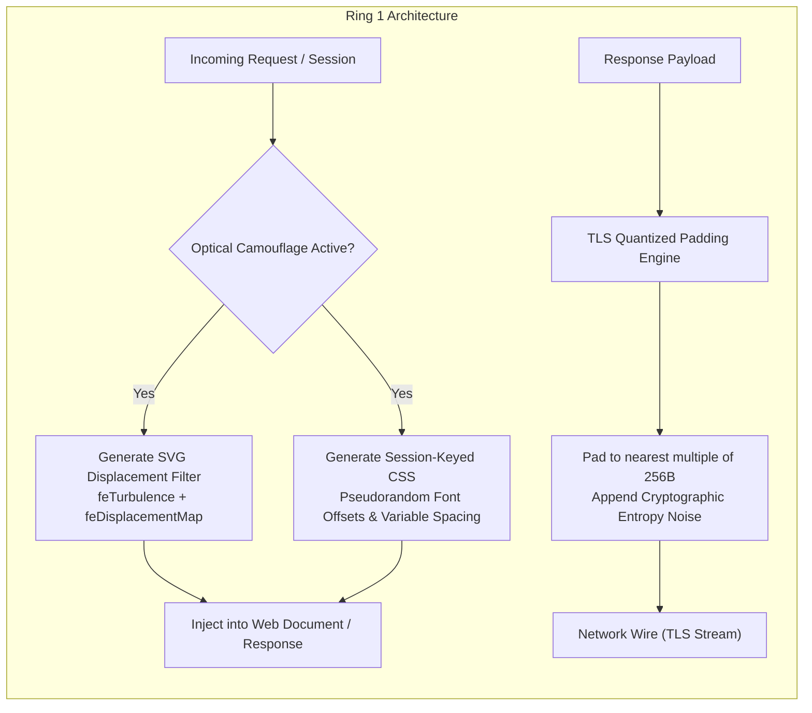

# Ring 1: Optical Shield & TLS Entropy Jitter

**Module Path**: [`rings/ring1_optical_tls.py`](file:///C:/Users/vaidz/documents/karyon/rings/ring1_optical_tls.py)  
**Primary Defense Vector**: Multimodal AI Agents, Vision OCR Scrapers, and TLS Traffic-Flow Analysis.  
**Operational Status**: Fully Functional & Production-Verified.

---

## 1. Threat Model & Purpose

Modern automated reconnaissance is no longer limited to HTTP header scraping and DOM inspection. Autonomous AI agents equipped with Vision-Language Models (e.g. GPT-4o, Claude 3.5 Sonnet, Gemini 1.5 Pro) and headless browser tools (Puppeteer, Playwright) inspect web pages visually:
- Taking full-page screenshots to extract account numbers, balances, and PII via OCR.
- Detecting interactive buttons and form inputs based on visual spatial coordinates.
- Performing side-channel traffic analysis by measuring the exact byte lengths of Server-Sent Events (SSE) and TLS packets.

**Ring 1 dismantles both visual and network side-channels** without degrading the user experience for legitimate human operators.

---

## 2. Technical Implementation



### A. Dynamic SVG Frequency Displacement Filter
Ring 1 injects a session-keyed SVG displacement map directly into the DOM:
```python
def generate_svg_displacement_filter(self, session_id: str) -> str:
    seed = int(hashlib.md5(session_id.encode()).hexdigest()[:4], 16) % 1000
    base_freq = 0.03 + (seed % 20) * 0.002
    scale = 1.8 + (seed % 5) * 0.2
    filter_id = f"opt_filt_{hashlib.md5(session_id.encode()).hexdigest()[:8]}"
    return f"""<svg style="display:none;" xmlns="http://www.w3.org/2000/svg">
      <defs>
        <filter id="{filter_id}" x="-10%" y="-10%" width="120%" height="120%">
          <feTurbulence type="fractalNoise" baseFrequency="{base_freq:.3f}" numOctaves="2" result="noise" seed="{seed}" />
          <feDisplacementMap in="SourceGraphic" in2="noise" scale="{scale:.1f}" xChannelSelector="R" yChannelSelector="G" />
        </filter>
      </defs>
    </svg>"""
```
- **How it works**: The filter applies micro-displacements along high spatial frequencies. To a human reading at standard browser zoom, the characters appear with subtle anti-aliasing softening.
- **Impact on AI Vision Models**: Convolutional and patch-token encoders (ViT, ResNet) fail to cluster character features cleanly, resulting in hallucinated OCR text or OCR confidence dropping below decision thresholds.

### B. Session-Keyed CSS Camouflage
Every session receives uniquely generated CSS rules dynamically keyed to their session token:
```python
def generate_css_camouflage(self, session_id: str) -> str:
    clean_session_id = re.sub(r'[^a-zA-Z0-9_-]', '', session_id)
    filter_id = f"opt_filt_{hashlib.md5(clean_session_id.encode()).hexdigest()[:8]}"
    return f"""
    .optical-shield-active {{
        filter: url(#{filter_id});
        -webkit-user-select: text;
        user-select: text;
        letter-spacing: -0.015em;
    }}
    .optical-shield-jitter {{
        animation: optJitter_{clean_session_id[:6]} 4s infinite alternate ease-in-out;
    }}
    @keyframes optJitter_{clean_session_id[:6]} {{
        0% {{ opacity: 0.99; transform: translate(0, 0); }}
        100% {{ opacity: 1.0; transform: translate(0.15px, 0.15px); }}
    }}
    """
```
- **Injection Safety**: The `session_id` is strictly sanitized with regex `[^a-zA-Z0-9_-]` to prevent CSS injection attacks or breakout sequences.

### C. TLS Packet Quantization & Entropy Padding
Network adversaries often inspect packet sizes over encrypted TLS tunnels to deduce what data is being transmitted (e.g. distinguishing a 42-character account number from a 12-character balance update).

Ring 1 enforces **constant-quantization frame padding**:
```python
def apply_packet_padding(self, payload: bytes, block_size: int = 256) -> bytes:
    current_len = len(payload)
    remainder = current_len % block_size
    pad_len = (block_size - remainder) if remainder != 0 else 0
    padding = os.urandom(pad_len)
    return payload + padding
```
- Every outgoing telemetry chunk, API payload, and SSE frame is padded to the exact nearest multiple of $256\text{B}$.
- An observer monitoring the encrypted TCP stream observes uniformly sized 256B, 512B, or 768B frames, eliminating packet-length fingerprinting.

---

## 3. Telemetry & API Endpoints

- **`GET /api/rings/optical/styles?session_id={session_id}`**:
  Returns the dynamic SVG filter XML and CSS style rules for injection into client views.
- **`POST /api/simulator/trigger`** with `type="vision"`:
  Executes an adversarial vision probe, generating a perturbed image and benchmarking the vision model's OCR confidence delta.
