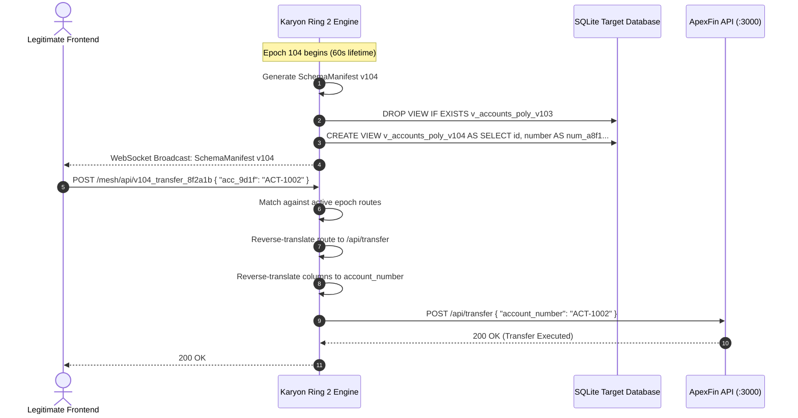

# Ring 2: Polymorphic Mesh & Ephemeral Schema

**Module Path**: [`rings/ring2_polymorph.py`](file:///C:/Users/vaidz/documents/karyon/rings/ring2_polymorph.py)  
**Primary Defense Vector**: Broken Object Level Authorization (BOLA), Insecure Direct Object References (IDOR), API Scraping, and Stolen API Documentation.  
**Operational Status**: Fully Functional & Production-Verified.

---

## 1. Threat Model & Purpose

In modern cloud applications, API routes (`/api/accounts`, `/api/transfer`) and database schemas (`account_number`, `balance`) remain static for months or years. Once an attacker or autonomous agent discovers an unauthenticated or improperly scoped endpoint, they can automate queries indefinitely.

**Ring 2 treats the entire API and schema surface as ephemeral**:
- API routes and table columns rotate every **60 seconds** (Epoch Rotation).
- Requests sent to outdated or expired routes decay into non-actionable signatures and are transparently diverted into honeypot traps.
- Legitimate clients receive continuous, transparent reverse-proxy translation.

---

## 2. Technical Implementation



### A. Dynamic Route Aliasing
Canonical routes are mapped into cryptographically seeded ephemeral slugs:
```python
# Canonical route definitions
CANONICAL_ROUTES = [
    "/api/accounts",
    "/api/transfer",
    "/api/transactions",
    "/api/auth/session"
]

# Generated polymorphic route format:
# /mesh/api/v{epoch}_{route_slug}_{hash[:10]}
# Example: /mesh/api/v104_transfer_9c34d8ef01
```

### B. Ephemeral SQLite View Virtualization
Rather than performing slow and risky schema migrations on the live production tables, Ring 2 creates lightweight, high-performance SQL Views with zero table locking:
```python
def apply_sqlite_view(self, manifest: SchemaManifest):
    # Strict regex check to prevent Second-Order SQL injection
    if not re.match(r"^[a-zA-Z0-9_]+$", manifest.active_view_name):
        raise ValueError(f"Invalid view name: {manifest.active_view_name}")

    cols = manifest.column_mappings.get("accounts", {})
    sanitized_aliases = []
    for canonical_col, alias in cols.items():
        if not re.match(r"^[a-zA-Z0-9_]+$", canonical_col) or not re.match(r"^[a-zA-Z0-9_]+$", alias):
            raise ValueError(f"Invalid column or alias name: {canonical_col} -> {alias}")
        sanitized_aliases.append(f"{canonical_col} AS {alias}")

    select_clause = ", ".join(sanitized_aliases)
    
    with get_connection() as conn:
        cursor = conn.cursor()
        # Drop previous view
        prev_view = f"v_accounts_poly_v{manifest.version - 1}"
        cursor.execute(f"DROP VIEW IF EXISTS {prev_view}")
        # Create fresh view
        create_sql = f"CREATE VIEW IF NOT EXISTS {manifest.active_view_name} AS SELECT {select_clause} FROM accounts;"
        cursor.execute(create_sql)
        conn.commit()
```
- **Security Control**: Both table column names and generated alias identifiers are strictly checked with `^[a-zA-Z0-9_]+$` to eliminate any risk of Second-Order SQL injection during dynamic view creation.

### C. Transparent Reverse Proxy Translation
When legitimate requests arrive at Karyon, the proxy inspects the active `reverse_routes` map:
- If the route matches the active epoch, the request is translated to its canonical internal route and dispatched to the target application.
- If the route matches a retired epoch, Ring 2 flags the request as an unauthorized probe and hands execution over to **Ring 4 (Shadow Honeypot)**.

---

## 3. Cognitive Route Generation & Fallback

Ring 2 queries **Meta Muse Spark** using structured microservice ingress terminology:
```python
prompt = (
    f"Generate structured ingress routing tokens and abstracted schema field labels for microservice cluster epoch {epoch}. "
    f"Canonical endpoints: {CANONICAL_ROUTES}. "
    f"Canonical schema fields: {CANONICAL_ACCOUNT_COLUMNS}. "
    f"Return a JSON object with keys 'routes' and 'columns'."
)
```
- If the cloud AI model is unavailable, rate-limited, or unresponsive, the **deterministic cryptographic generator** (`generate_crypto_fallback_manifest`) instantly synthesizes HMAC-SHA256 salted tokens in $< 1\text{ms}$.

---

## 4. Telemetry & API Endpoints

- **`GET /api/rings/poly/manifest`**: Returns the current active `SchemaManifest` with expiration timestamp and column mappings.
- **`WS /ws/manifest`**: Emits real-time JSON payloads whenever a new 60-second epoch is rotated.
- **`POST /api/simulator/trigger`** with `type="schema"`: Simulates an expired schema probe and validates honeypot capture.
