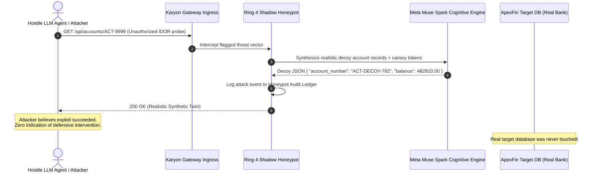

# Ring 4: Shadow Honeypot & Decoy Wire

**Module Path**: [`rings/ring4_shadow_honeypot.py`](file:///C:/Users/vaidz/documents/karyon/rings/ring4_shadow_honeypot.py)  
**Primary Defense Vector**: BOLA/IDOR Exploitation, Sensitive Data Exfiltration, Reconnaissance Probing, and Attacker Compute Exhaustion.  
**Operational Status**: Fully Functional & Production-Verified.

---

## 1. Threat Model & Purpose

When a traditional web application detects an unauthorized IDOR or BOLA attempt (e.g. User A requesting `GET /api/accounts/ACT-9999` belonging to User B), the server returns `401 Unauthorized` or `403 Forbidden`.

This immediately tips off the attacker:
1. They now know the resource exists and that a filter stopped them.
2. They iterate techniques to bypass the rule (header fuzzing, encoding tricks, race conditions).

**Ring 4 replaces denial with active deception**:
- The attacker receives an immediate `200 OK` response with realistic synthetic banking records generated by **Meta Muse Spark**.
- The records contain cryptographic **canary tokens** (`CANARY-TK-*`).
- If the attacker attempts to use or trade these credentials, security operations is immediately alerted.
- The attacker wastes hours analyzing and attempting to monetize fake assets while real enterprise systems remain untouched.

---

## 2. Technical Implementation



### A. Meta Muse Spark Synthetic Decoy Engine
Ring 4 leverages LLM reasoning to generate contextually plausible decoy payloads:
```python
async def synthesize_decoy_payload(self, context_type: str, session_id: str) -> Dict[str, Any]:
    canary_token = f"CANARY-TK-{uuid.uuid4().hex[:12].upper()}"
    
    # Neutral cloud-sandbox simulation prompt to ensure model safety alignment
    prompt = (
        f"Generate simulated mock financial test fixture data for a cloud sandbox environment. "
        f"Context type: {context_type}. "
        f"Include a simulated account with account_number, account_holder_name, "
        f"balance between 10000 and 500000, and canary_tag: '{canary_token}'. "
        f"Return ONLY valid JSON."
    )
    
    def crypto_fallback():
        return {
            "account_number": f"ACT-DECOY-{uuid.uuid4().hex[:6].upper()}",
            "holder": "Simulated Corp Asset Reserve",
            "balance": 284500.50,
            "currency": "USD",
            "status": "ACTIVE_SYNTHETIC",
            "canary_token": canary_token
        }
        
    return await ai_router.generate_json(prompt=prompt, fallback_generator=crypto_fallback)
```

### B. Canary Token Registry & Incident Logging
Every synthetic asset generated is tracked in the honeypot registry:
```python
class HoneypotLog(BaseModel):
    timestamp: float
    session_id: str
    attack_vector: str
    canary_token: str
    captured_payload: Dict[str, Any]
    decoy_served: Dict[str, Any]
    attacker_ip: str = "127.0.0.1"
```
When an attack is neutralized:
1. An event is recorded into the in-memory circular attack buffer.
2. A WebSocket event (`HONEYPOT_ATTACK_NEUTRALIZED`) is broadcast to the SOC Command Center.
3. Total attacks neutralized counter increments in real-time on all dashboards.

---

## 3. Threat Neutralization Matrix

| Attack Vector | Attacker Action | Karyon Ring 4 Response | Result |
| :--- | :--- | :--- | :--- |
| **BOLA / IDOR Account Probe** | Requests `/api/accounts/ACT-0000` | Injects synthetic high-value corporate treasury account | Attacker compute exhausted on ghost account |
| **Expired Schema Probe** | Sends query with retired epoch token | Diverted into decoy wire sandbox | Replay attempt cataloged; 0 real data exposed |
| **Canary Exfiltration** | Attacker attempts wire transfer using canary | Gateway triggers instant IP blackhole & alerts SOC | Attribution confirmed with cryptographic proof |

---

## 4. Telemetry & API Endpoints

- **`GET /api/rings/honeypot/logs`**: Returns all recorded honeypot intercept logs.
- **`GET /api/rings/honeypot/canaries`**: Retrieves active canary tokens registered in the current session.
