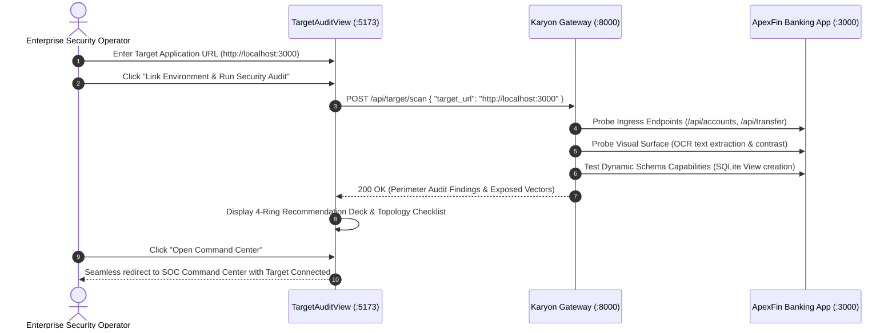

# Target Integration & Perimeter Audit

**Target Backend Path**: [`target_app/api.py`](file:///C:/Users/vaidz/documents/karyon/target_app/api.py)  
**Target Frontend Path**: [`target_frontend/src/App.tsx`](file:///C:/Users/vaidz/documents/karyon/target_frontend/src/App.tsx)  
**Audit View Path**: [`frontend/src/components/telemetry/TargetAuditView.tsx`](file:///C:/Users/vaidz/documents/karyon/frontend/src/components/telemetry/TargetAuditView.tsx)  
**Operational Status**: Fully Functional & Production-Verified.

---

## 1. Overview: The ApexFin Target Application

To provide an authentic, realistic enterprise demonstration, Karyon includes a complete financial banking application — **ApexFin Target Bank** (`:3000`):
- **Core Banking Operations**: Supports customer account balances, funds transfers (`/api/transfer`), transaction histories, and session authentication.
- **Enterprise Storage**: Backed by a thread-safe SQLite database (`target_app/database.py`) with Write-Ahead Logging (`WAL`) mode enabled and busy timeouts.
- **Security Audit Logging**: Every transaction, deposit, and ledger adjustment is logged to a persistent transfer audit trail.
- **Meta-Inspired UI**: Built in React 19 + Tailwind CSS with Meta Inter typography (`font-sans`), tabular figures (`tnum`), and zero monospace fonts.

---

## 2. Pre-Flight Perimeter Audit Workflow

When an enterprise links their system (`:5173/?view=audit`), Karyon conducts a comprehensive pre-flight security audit:

---

## 3. Perimeter Audit Findings & Recommendations

The audit automatically detects exposed vulnerabilities in the target application and matches them with Karyon's defense rings:

| Vulnerability Surface | Risk Severity | Target App Exposure | Karyon Defensive Provisioning |
| :--- | :--- | :--- | :--- |
| **BOLA / IDOR Endpoints** | `Critical` | Static account routing (`/api/accounts/{id}`) vulnerable to enumeration. | **Ring 2: Polymorphic Mesh** 60s route rotation & reverse proxy remapping. |
| **Vision & OCR Scraping** | `High` | Clean rendered text easily scraped by automated vision models. | **Ring 1: Optical Shield** High-frequency SVG displacement & session CSS. |
| **RAG & Context Poisoning** | `Critical` | Unsanitized prompt inputs injected into multi-turn context memory. | **Ring 3: KV-Surgeon** Merkle DAG tracking & sub-120ms RoPE eviction. |
| **Automated Reconnaissance** | `Medium` | Probing endpoints return `403 Forbidden` revealing attack surface. | **Ring 4: Shadow Honeypot** Meta Muse Spark synthetic twins with canary tokens. |

---

## 4. Reverse Proxy Integration

Once the target application is linked to Karyon, all incoming client traffic is routed through Karyon's gateway on port `8000`:
- **Legitimate requests** are transparently translated and forwarded to the target application on port `3000`.
- **Responses** from port `3000` are received by Karyon, padded to 256-byte boundaries (Ring 1), injected with optical camouflage if requested, and returned to the client.
- **Malicious requests** are quarantined at the gateway level and served deceptive synthetic twins without ever reaching port `3000`.
